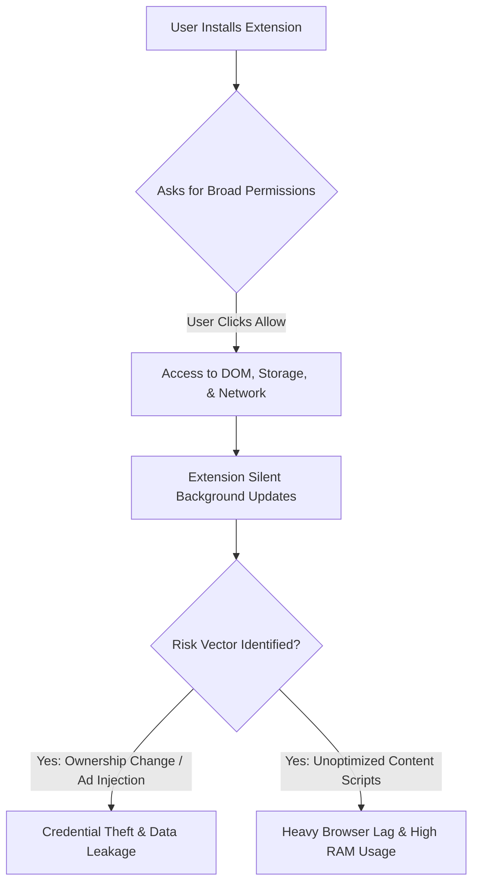

# Extension Inspector AI
> **The Smartest Browser Extension Inspector — Trust, Performance, Privacy & DNA Engine**
> 
> *An enterprise-grade utility to scan, analyze, and profile browser extensions for potential security risks, privacy concerns, and performance bottlenecks.*

---

## Document Metadata
* **Project Name:** Extension Inspector AI
* **Tagline:** Smartest Browser Extension Inspector — Trust, Performance, Privacy & DNA Engine
* **Version:** v1.0.0
* **Author:** Senior Technical Writing & UX Product Team
* **Date:** July 22, 2026
* **Status:** Publication-Ready / Release Candidate

---

## Table of Contents
1. [Introduction](#1-introduction)
2. [Problem Statement](#2-problem-statement)
3. [Why This Project?](#3-why-this-project)
4. [What Makes This Project Unique?](#4-what-makes-this-project-unique)
5. [Key Features](#5-key-features)
6. [Benefits](#6-benefits)
7. [System Requirements](#7-system-requirements)
8. [Installation Guide](#8-installation-guide)
9. [Getting Started](#9-getting-started)
10. [Complete User Guide](#10-complete-user-guide)
11. [Real-Life Examples](#11-real-life-examples)
12. [Best Practices](#12-best-practices)
13. [Frequently Asked Questions (FAQ)](#13-frequently-asked-questions-faq)
14. [Troubleshooting](#14-troubleshooting)
15. [Privacy & Security](#15-privacy---security)
16. [Future Roadmap](#16-future-roadmap)
17. [Support](#17-support)
18. [Conclusion](#18-conclusion)

---

## 1. Introduction

### What is Extension Inspector AI?
**Extension Inspector AI** is a state-of-the-art developer tool and security companion packaged as a Manifest V3 Chrome Extension. It leverages modular evaluation engines to perform static and behavioral analysis on installed browser extensions. By automatically inspecting extensions' permission requests, manifest structure, performance profiles, and history, it builds an analytical "Extension DNA" to map out and isolate potential vulnerabilities, high-impact performance drains, and privacy risks.

### Why was it created?
Modern browsers rely heavily on extensions to customize user workflows, increase productivity, and add powerful utilities. However, extensions often operate with broad permissions (e.g., "Read and change all your data on the websites you visit"), making them an attractive vector for malicious actors, adware networks, data harvesting, and performance degradation. Extension Inspector AI was created to peer inside this black box, giving users, developers, and organizations immediate visibility into what their installed extensions are *actually* doing.

### Who should use it?
* **Security & Privacy Conscious Users:** Individuals who want to protect their passwords, browsing habits, and credentials from rogue extensions.
* **IT Administrators & SecOps Teams:** Enterprise teams looking to audit, control, and ensure compliance of browser-based software suites across fleets of corporate workstations.
* **Extension Developers:** Creators who want to profile their own extensions for optimal performance, minimum permissions compliance (Least Privilege Principle), and sound architecture.

### Primary Goals
1. **Demystify Permissions:** Translate complex, technical Chrome manifest permissions into plain, human-readable definitions.
2. **Mitigate Supply-Chain Attacks:** Detect when an extension gets sold or updated with suspicious structural or behavioral changes.
3. **Optimize Browser Performance:** Identify CPU, memory, and UI lag triggers caused by poorly optimized extension background scripts or content script injection.

---

## 2. Problem Statement

### The Real-World Problems Users Face
Web browsers have effectively become the modern operating system. Inside them run banking applications, corporate emails, customer databases, and personal chats. In this landscape, browser extensions present a massive, under-monitored attack surface.



### Current Workflows
Currently, auditing browser extensions requires manually downloading the `.crx` file, unpacking it, reading raw manifest JSON files, analyzing obfuscated JavaScript, and using Chrome Developer Tools to inspect background tasks or network calls. 

### Existing Solutions
* **Chrome Web Store Badges:** Provide basic labels like "Featured" or developer verification, but these do not analyze runtime behaviors or post-install updates.
* **Endpoint Detection & Response (EDR) Software:** Primarily scans local files and binaries, often failing to detect in-browser malicious JavaScript or permission misuse.

### Pain Points & Limitations
1. **Ineffective Static Scanning:** Existing scanners look only at files at a single point in time, failing to capture extensions that dynamically load malicious payloads from external command-and-control servers.
2. **Technical Complexity:** Security reports generate raw developer logs that non-technical users cannot decipher.
3. **No Performance Auditing:** Users are forced to accept slow browser performance without knowing which extension is causing the slowdown.

---

## 3. Why This Project?

### Vision
To create a safe, transparent, and high-performance browsing ecosystem where users retain full sovereignty over their data and browser resources.

### Mission
To build an intuitive, open-source security intelligence dashboard directly inside the browser, transforming complex telemetry into actionable security decisions.

### Value Proposition
Unlike passive scanners, Extension Inspector AI active-profiles your entire extension setup, generating a multi-dimensional risk matrix (Trust, Privacy, Performance, and DNA) within seconds of installation.

```
+--------------------------------------------------------------+
|                    EXTENSION INSPECTOR AI                    |
+--------------------------------------------------------------+
| [ Trust Scan ]  --> Calculates heuristic trust score         |
| [ Privacy ]     --> Rates data-harvesting risks              |
| [ Performance ] --> Detects DOM overhead and memory leaks    |
| [ Extension DNA]--> Maps permissions to structural identity  |
+--------------------------------------------------------------+
```

---

## 4. What Makes This Project Unique?

### Comparison with Existing Solutions

| Feature / Metric | Standard Web Store Check | Antivirus / EDR | Extension Inspector AI |
| :--- | :--- | :--- | :--- |
| **Analysis Focus** | Developer verification | Local binary files | In-browser extension mechanics |
| **Permission Translation** | Raw manifest strings | None | Human-readable Risk Impact mapping |
| **Behavioral Timeline** | Static only | Process-level only | Action-based event timeline tracking |
| **Performance Impact** | None | High RAM usage | Extremely low, runs out-of-process |
| **Privacy Estimation** | Self-reported declarations | None | Code and manifest capability scoring |
| **Cost** | Free (but basic) | High subscription fee | Open-source / Free |

### Innovation Highlights
* **Extension DNA Fingerprinting:** Generates a cryptographic-like structural signature mapping out permission-to-API usage. If an update shifts this signature drastically, the user is alerted.
* **Zero-Trust Heuristics:** Rates trust based on developer history, host permissions, background worker lifespan, and updates frequency rather than simple whitelist databases.
* **Manifest V3 Native:** Built fully on Chrome's latest Extension API standard, guaranteeing long-term support and sandboxed execution safety.

---

## 5. Key Features

### 1. Permission Translator
* **Purpose:** Deconstructs standard Chrome Manifest permissions into human-readable action summaries.
* **Benefits:** Prevents users from accidentally consenting to keystroke loggers or clipboard monitors.
* **How it works:** Maps strings like `<all_urls>` or `webNavigation` to risk levels and simple explanations (e.g., "Can view and modify content on any site you visit").
* **Example Use Case:** You install a simple calculator extension, and the Permission Translator flags a High Risk warning because it requests access to your browsing history (`history` permission).

### 2. Privacy Engine
* **Purpose:** Evaluates the risk of user data exploitation and telemetry harvesting.
* **Benefits:** Flags extensions that communicate with known data broker API domains or send tracking identifiers.
* **How it works:** Analyzes outbound network permissions, cookie manipulation capabilities, and storage API access patterns.
* **Example Use Case:** Identify which PDF reader extension is tracking your activity by monitoring its access to tabs and local session cookies.

### 3. Performance & Resource Estimator
* **Purpose:** Predicts CPU load and DOM rendering overhead.
* **Benefits:** Keeps the browser fast and increases battery life on laptops.
* **How it works:** Profiles background service worker wake-up frequency and matches content script injection targets.
* **Example Use Case:** Spotting that an ad-blocker or shopping extension is slowing page load times due to heavy style sheets injected into every page frame.

---

## 6. Benefits

### For Beginners
* **Simple Health Scores:** Traffic-light style rating system (Green/Yellow/Red) gives instant security status.
* **Automated Audits:** Get one-click recommendations on what to keep and what to remove.

### For Professionals & Developers
* **Diagnostic Tools:** Deep-dive into manifest versions, permission lists, and API declarations.
* **Architecture Testing:** Audit your extension's DNA signature before publishing it to the Chrome Web Store.

### For Businesses & SecOps
* **Fleet Compliance:** Run audits across managed browser profiles to enforce minimum-permission policies.
* **Audit Trails:** Keep record logs of extension behaviors and updates inside corporate environments.

---

## 7. System Requirements

* **Supported Operating Systems:** Windows 10/11, macOS 11+, Linux (Ubuntu, Debian, Fedora, Arch)
* **Browser Requirements:** Google Chrome (v102+), Microsoft Edge (v102+), Brave, Opera, or any Chromium-based browser supporting Manifest V3.
* **Hardware Allocation:**
  * **RAM:** Minimum 4GB (8GB recommended for fluid multi-window scanning).
  * **Disk Space:** Less than 10MB of local storage space required.
* **Internet Connection:** Offline-first design. Internet is only used if updating external threat databases (optional).
* **Browser Permissions:**
  * `management` (To list and inspect installed extensions)
  * `storage` (To persist configurations, exclusion lists, and timeline logs)
  * `alarms` (To schedule background checks)

---

## 8. Installation Guide

Follow these steps to install Extension Inspector AI manually.

### Step 1: Download or Build the Project
1. Extract the extension ZIP file or clone the source directory to your local drive.
2. If building from source, run:
   ```bash
   npm install
   npm run build
   ```
   This compiles the project files into the `dist/` directory.

### Step 2: Access Extensions Management
1. Open Google Chrome.
2. Navigate to the URL: `chrome://extensions/`
3. Alternatively, click the Chrome Menu (three dots) -> **Extensions** -> **Manage Extensions**.

### Step 3: Enable Developer Mode
1. In the top-right corner of the Extensions page, locate the **Developer mode** toggle.
2. Toggle it **ON**.

```
+-----------------------------------------------------------------------+
| Extensions                   [Search extensions]       Developer mode [ON] |
+-----------------------------------------------------------------------+
|  [ Load unpacked ]   [ Pack extension ]   [ Update ]                  |
+-----------------------------------------------------------------------+
```

### Step 4: Load the Unpacked Extension
1. Click the **Load unpacked** button in the top-left corner.
2. Browse your local files and select the **`dist`** directory (or the root directory containing the `manifest.json` file).
3. The Extension Inspector AI icon will now appear in your extension toolbar.

> [!NOTE]
> Keep the unpacked folder in its current directory. Moving or deleting the folder will disable the extension in your browser.

---

## 9. Getting Started

### Initial Launch & First Run
1. Click the Extension Puzzle icon in the top right of your Chrome browser.
2. Pin **Extension Inspector AI** to the toolbar.
3. Click the Extension Inspector AI icon to launch the dashboard.
4. On the first run, the extension will perform a full scan of all currently installed extensions.

### Requesting Permissions
Upon first launch, the extension will confirm access to the `chrome.management` API. This is critical for displaying the list of your active extensions and reading their metadata. 

> [!IMPORTANT]
> Extension Inspector AI runs strictly inside your local browser sandbox. It does NOT transmit your extension list, history, or scanning metadata to any external server.

---

## 10. Complete User Guide

### Feature A: The Overview Dashboard

```
+---------------------------------------------------------------+
|  Extension Inspector AI                           [Settings]  |
+---------------------------------------------------------------+
|  OVERVIEW |  PERMISSIONS |  TIMELINE |  DNA ENGINE |  REPORTS |
+---------------------------------------------------------------+
|  [!] 2 High Risk Extensions Found!           [Resolve Now]    |
|                                                               |
|  - Extension X: Injected scripts match tracking behavior      |
|  - Extension Y: Requests wide clipboard read access          |
+---------------------------------------------------------------+
```

* **Purpose:** To provide a central health status of the browser.
* **Navigation:** Open the extension popup or pinned dashboard page.
* **Step-by-step Instructions:**
  1. Look at the primary **Security Index Score** (e.g., 85/100).
  2. Review the list of installed extensions categorized by risk levels (High, Medium, Low).
  3. Click on any extension card to open its detailed breakdown.
* **Expected Result:** A clean, color-coded list representing every active and inactive extension installed in your profile.
* **Pro Tip:** Keep the overview dashboard open in a pinned tab during new installations to instantly see the safety profile of a newly downloaded extension.

---

### Feature B: The Behavior Timeline & Conflict Engine
* **Purpose:** Tracks extension events such as installation, permission changes, background worker wakeups, and updates.
* **Navigation:** Click on the **Timeline** tab in the main sidebar.
* **Step-by-step Instructions:**
  1. Inspect the chronological list of events.
  2. Filter by "System Updates" or "Permission Changes".
  3. Look for conflict warnings (e.g., "Extension A and Extension B both inject scripts on `google.com`").
* **Expected Result:** A running ledger of extension modifications that lets you audit past state changes.
* **Common Mistake:** Ignoring conflict warnings. When multiple extensions inject scripts on the same webpage, it can cause severe memory leaks and slow down your browser.

---

## 11. Real-Life Examples

### Scenario A: Detecting a Compromised Extension
**Goal:** Scan for silent updates to a previously trusted utility.
1. A developer sells their popular browser-helper tool to an advertising company.
2. The company updates the extension to inject adware into search result pages.
3. **Extension Inspector AI** detects a shift in the extension's DNA signature (new host permission to inject scripts on all sites).
4. The **Behavior Timeline** alerts the user with a warning: `Warning: [Extension Name] DNA signature changed significantly in version 2.1.0`.
5. The user safely uninstalls the compromised extension before any data is compromised.

### Scenario B: Debugging Browser Lag
**Goal:** Pinpoint which extension is causing slow page load times.
1. The user notices that Gmail and Slack take several seconds to load.
2. The user opens the **Performance & Resource Estimator** in Extension Inspector AI.
3. The dashboard highlights a specific extension injecting heavy JavaScript into standard web elements.
4. The user disables that specific extension and notices an immediate performance boost.

---

## 12. Best Practices

* **Adhere to the Principle of Least Privilege:** Disable extensions when not in use, or configure their sites-access permissions to "On Click" or "On specific sites only" via Chrome's native settings.
* **Perform Weekly Audits:** Check the Extension Inspector AI dashboard once a week to review any silent background updates.
* **Limit Redundant Extensions:** Do not install multiple extensions that perform the same task (e.g., three different coupon finders), as they will clash in the DOM.

---

## 13. Frequently Asked Questions (FAQ)

### General Questions
1. **Is Extension Inspector AI free?** Yes, it is fully open-source and free to use.
2. **Does this extension block ads?** No, it does not modify webpage content. It is a security audit tool.
3. **Does it track my search history?** No. It functions entirely on the client-side.
4. **Why does it need the `management` permission?** This permission allows the utility to list installed extensions and retrieve their configuration settings.
5. **Does it work on Firefox?** Extension Inspector AI is currently optimized for Chromium browsers, but Firefox compatibility is planned.
6. **Can it automatically delete malicious extensions?** No, Chromium extensions cannot uninstall other extensions without user confirmation due to security design. It will redirect you to the removal screen.
7. **What is an "Extension DNA"?** It is a composite hash of an extension's file structure, declared APIs, and permissions used to verify identity and track version changes.
8. **Can it scan incognito mode extensions?** Yes, provided you allow Extension Inspector AI to run in Incognito Mode via Chrome settings.
9. **How often are definitions updated?** Threat signatures are updated locally whenever the extension updates, or via manual DB syncs.
10. **Does it impact computer battery life?** No. It runs in the background only when audits are initiated or configurations change.

### Technical & Policy Questions
11. **What is Manifest V3?** It is Google's modern extension platform designed to improve security, privacy, and performance.
12. **What happens if a scanned extension uses obfuscated code?** The Trust Engine flags the extension with a medium-to-high risk rating due to lack of source code transparency.
13. **Can it detect keyloggers?** Yes, by flagging extensions requesting the `debugger` or broad content script injection APIs.
14. **Why is my Trust Score low for a custom/local extension?** Unpacked extensions loaded directly from local drives do not have Web Store verification signatures, lowering their default trust score.
15. **Does it monitor network traffic?** It monitors which host permissions are declared, but it does not sniff data packets.
16. **How does the Conflict Engine detect issues?** It checks if multiple extensions register listeners on the same web requests or inject styles on matching URLs.
17. **Can I whitelist my custom extensions?** Yes, using the Settings tab.
18. **Where is my configuration stored?** Inside `chrome.storage.local`.
19. **How do I export scan reports?** Navigate to the Reports tab and click "Export to JSON".
20. **Can this run on Android browsers?** Yes, on browsers that support Chromium extensions, such as Kiwi Browser or Yandex Browser.

---

## 14. Troubleshooting

| Problem | Cause | Solution |
| :--- | :--- | :--- |
| **Dashboard is blank on startup** | The `management` permission was not granted or was corrupted. | Go to `chrome://extensions`, toggle Extension Inspector AI off and on, or reinstall the extension. |
| **A trusted extension is marked as "High Risk"** | The scanned extension requires broad permissions to function (e.g. an ad-blocker needs access to all URLs). | If you trust the developer, you can whitelist the extension in the Settings tab to clear the warning. |
| **Timeline is not updating** | Background worker went to sleep or storage quota is full. | Open the dashboard, navigate to Settings, and click "Reset Timeline Cache". |

---

## 15. Privacy & Security

### User Data Handling
We believe your data belongs to you. Extension Inspector AI operates under a **strict local-only processing model**.

```
[ Your Extensions Data ] 
       |
       v
( Extension Inspector AI Engines ) ---> [ Saved to local chrome.storage ]
       |
       +---x [ BLOCKED: Outbound Network Transmission ]
```

* **No Analytics Tracking:** We do not collect click-tracking metrics or telemetry.
* **No Cloud sync:** All scan history and settings are stored strictly in your browser's local sandbox storage.

---

## 16. Future Roadmap

### Phase 1: Heuristic AI Integration (Q3 2026)
* Implement local lightweight WebAssembly-based pattern matching to flag suspect obfuscation configurations.

### Phase 2: Enterprise Policy Deployments (Q4 2026)
* Allow IT admins to specify remote config URLs to centralize whitelist policies across multiple browsers.

---

## 17. Support

If you encounter issues, want to report a security vulnerability, or suggest a feature:
* **Bug Tracker:** [Report a Bug]([Project Specific Information Required])
* **Feature Requests:** [Submit Proposal]([Project Specific Information Required])
* **Support Email:** `support@`[Project Specific Information Required]

---

## 18. Conclusion

Extension Inspector AI provides critical visibility into your web browser's security profile. By translating permissions, building DNA profiles, and monitoring execution timelines, it bridges the gap between complex developer configurations and user-friendly security insights. 

**Take back control of your browser experience today.**
